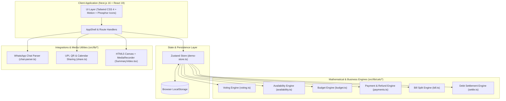
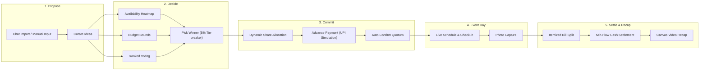
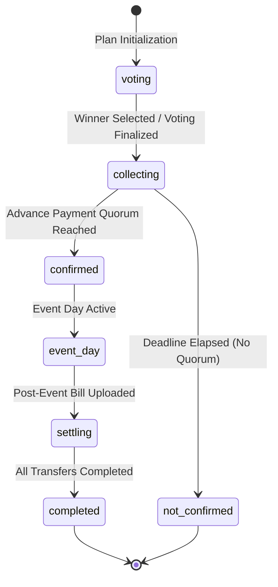

# Puran Poli — Architecture & Technical Specifications

> High-level engineering architecture, data flow pipelines, state machine models, and mathematical engines.

---

## 1. System Architecture Overview

The application is structured as a client-first, serverless architecture using Next.js 16 (App Router), React 19, and Tailwind CSS 4. All state management and computational engines execute deterministically within the browser environment.

---

## 2. End-to-End User Flow & Lifecycle

---

## 3. Plan State Lifecycle Machine

---

## 4. Computational Engines & Algorithms

### 4.1 Fair Voting Engine (`src/lib/calc/voting.ts`)
- **Blind Voting**: Ballots remain hidden until voter submission or voting deadline.
- **Scoring Weights**:
  - `Love it`: +2 points
  - `Okay`: +1 point
  - `No`: 0 points
  - `Veto`: Disqualifies the idea if threshold is reached.
- **5% Tie-Breaker**: If top two ideas are within 5% score margin, the tie-breaker checks budget satisfaction, required member consensus, and organizer weight.

### 4.2 Dynamic Share & Refund Calculus (`src/lib/calc/payments.ts`)
- Target total amount $T$ divided dynamically across $N$ committing members:
  $$\text{Share} = \lceil T / N \rceil$$
- As additional members commit ($N \to N+1$), the per-person share decreases:
  $$\text{Refund per existing member} = \text{Share}_N - \text{Share}_{N+1}$$
- Excess funds are automatically returned as credits.

### 4.3 Minimum Cash Flow Settlement (`src/lib/calc/settle.ts`)
- Computes net balance $B_i$ for each person $i$:
  $$B_i = \text{Total Paid}_i - \text{Total Consumed}_i$$
- Applies the greedy debt-simplification algorithm to settle all balances in at most $N-1$ transactions.
- Produces direct 1-click UPI links (`upi://pay?pa=...&am=...`) and instant QR codes.
