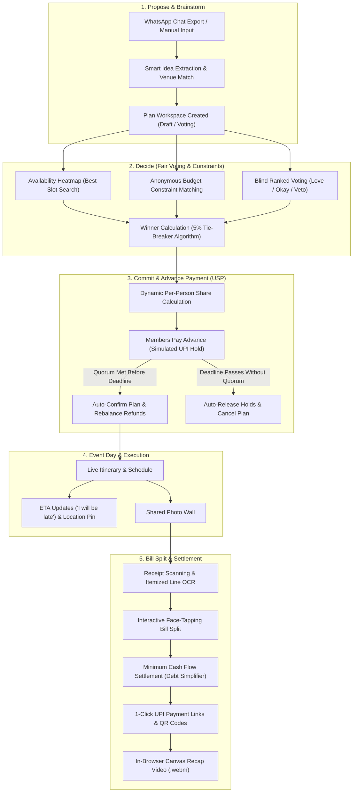
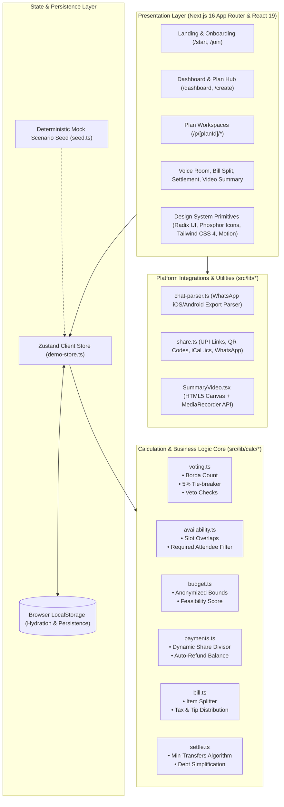
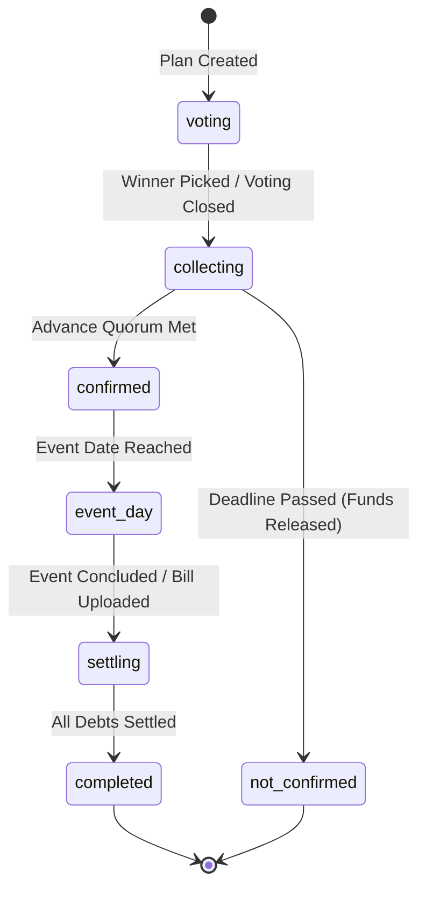

# Group Event Planner — frontend prototype (CodeAstra 2.0, Round 1)

A frontend-only, fully clickable prototype of the group event planning platform described in
`allaboutourproject (3).md`, built to the visual contract in `DESIGN.md`
("Soft Clay & Calm Bento — Pop Sticker Edition").

**Propose → Decide → Pay → Confirm → Remind → Event day → Split the bill → Event summary**

> There is no backend. Every plan, vote, payment and bill lives in your browser (`localStorage`).
> Payments, OCR, AI and voice are clearly-labelled simulations. No money moves.

## Run it

```bash
npm install
npm run dev        # http://localhost:3000
```

Production check: `npm run build && npm start`. Other scripts: `npm run typecheck`, `npm run lint`.

## Demo script (≈3 minutes)

1. `/` → **Get started** → enter a name (no password).
2. **Weekend Hangout** (deciding): vote — results stay hidden until you submit; the 5% tie-breaker explains itself.
   Mark free hours on **When**, set a private budget on **Budget** and watch the idea labels update.
   As organiser, **Close voting & pick winner** (or wait for the deadline).
3. **Lonavala Villa Weekend** (5 of 6 paid): **Pay** → *Join and pay ₹2,000* → the plan confirms instantly.
   *Simulate next member paying* → share drops to ₹1,714 and ₹286 returns to each member.
   *Simulate deadline passing* on another collecting plan shows the "not confirmed → released" path (see **Goa Trip**).
4. **Final plan**: download the `.ics`, open Google Calendar, share to WhatsApp, copy the link.
5. **Import chat**: *Use sample chat* (or download the sample `.txt` and upload it) → pick ideas → add to a plan.
6. **Riya's Birthday Dinner**: **Bill split** (tap faces per item, toggle service charge) → **Settle** (minimum payments, UPI link + QR).
7. **Turf Football Night** (event day), **Juhu Sunset** (summary video made in the browser), **Voice room**, and the **venue console** (`/venues`).

**Reset before judging:** profile menu → *Reset demo data*, or Settings → *Reset demo data*.

## Routes

| Route | Screen |
|---|---|
| `/` | Landing page |
| `/start` | Demo sign-in (name only) |
| `/join`, `/join/[planId]` | Join by link/code, join a plan with name + 5 optional questions |
| `/dashboard` | Stats, needs-attention, filterable/searchable plans, upcoming, completed, activity |
| `/create` | Create plan → share link, QR code, WhatsApp |
| `/p/[planId]` | Plan workspace: next step, ideas, tools, deadlines, members, activity |
| `/p/[planId]/vote` | Fair voting (Love it / Okay / No, one veto, hidden results, tie-breaker, "why did this win") |
| `/p/[planId]/when` | Availability heatmap (drag-select grid on desktop, day tabs on mobile, required members) |
| `/p/[planId]/budget` | Private budget + conditions; only aggregates are ever shown |
| `/p/[planId]/pay` | Advance-payment confirmation (USP) with demo controls |
| `/p/[planId]/final` | Confirmed plan, `.ics`, Google Calendar, WhatsApp share |
| `/p/[planId]/voice` | Voice room (consent, timer, scripted transcript, detected updates, confirm) |
| `/p/[planId]/event` | Event day: schedule, arrivals, "I will be late", photos, simulated live video |
| `/p/[planId]/bill` | Receipt scan (demo extraction) + editable item-wise split |
| `/p/[planId]/settle` | Minimum-payment settlement, UPI links/QR, expenses |
| `/p/[planId]/summary` | Highlights, timeline, photos, settlement, canvas/MediaRecorder recap video |
| `/import` | WhatsApp chat import (local parser) |
| `/notifications`, `/settings`, `/venues` | Alerts, profile/preferences/reset, venue console |

## System Architecture & Flow Diagrams

### End-to-End User Flow


### System Architecture


### Plan State Machine Lifecycle


## Architecture

- **Next.js 16 App Router + React 19 + TypeScript (strict) + Tailwind CSS 4**, `motion`, Phosphor icons, Radix (dialog, dropdown, switch, slider), `zustand` (persisted store), `qrcode`.
- No API routes, server actions or backend services.
- `src/app/globals.css` — Design tokens (`@theme`), `bg-dots`, `bg-speed`, `skeleton`, motion.
- `src/lib/store/demo-store.ts` — single source of truth; all actions; `localStorage` persistence with safe hydration.
- `src/lib/mock-data/seed.ts` — deterministic scenario (10 people, 6 plans in every status).
- `src/lib/calc/*` — the documented business rules: voting score (§13.2), budget privacy (§13.3), best slot, share/refund maths (§9.1), bill split (§13.6), minimum transfers (§13.5).
- `src/lib/chat-parser.ts` — Android + iPhone WhatsApp export parser, noise filter, keyword extraction.
- `src/lib/share.ts` — UPI deep links, `.ics`, Google Calendar, WhatsApp share, image downscaling.
- `src/components/ui/*` — design-system components; `src/features/*` — feature components.


## Real vs simulated

| Real (runs in the browser) | Simulated (clearly labelled) |
|---|---|
| Voting maths, tie-breaker, veto, hidden results | Advance-payment holds/capture/release (no gateway) |
| Budget-fit labels & anonymous range | Other members' actions (demo controls) |
| Best-slot search with required members | Receipt OCR (demo line items, fully editable) |
| Share/refund calculation, auto-confirm, deadline watcher | Voice transcription (scripted transcript; optional local mic-level meter only) |
| WhatsApp `.txt` parsing & keyword extraction | Live location & live video |
| Bill split, settlement, UPI link + QR, `.ics` file | Push notifications (in-app only) |
| Summary video (canvas + MediaRecorder) | Real-time sync between devices |

Demo UPI handles end in `@demo-upi` and cannot receive money.
